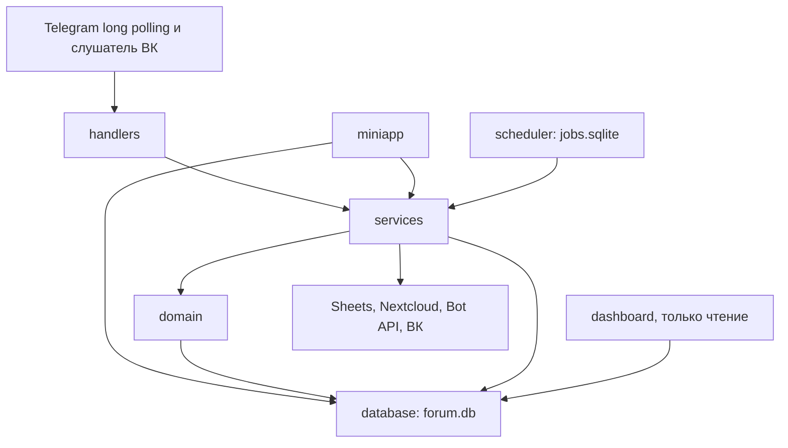

<!-- generated-by: gsd-doc-writer -->
# Архитектура

Один код на все мероприятия. Различия между форумом и конференцией живут в настройках SQLite, а не в отдельных ветках. На событие поднимается свой стек: процесс бота, Mini App и дашборд вокруг одного файла `data/forum.db`.

## Обзор системы

Бот принимает апдейты Telegram через long polling (`main.py` → `Dispatcher.start_polling`) и параллельно слушает сообщество ВК (`handlers/vk/vk_bot.py::start_vk_listener`). Делегат и менеджер ходят либо в чат, либо в Mini App. Mini App — отдельный процесс FastAPI на том же образе, что и бот (`docker-compose.yml`, сервис `miniapp`, `uvicorn miniapp.main:app` на порту 8001). Дашборд статистики — третий процесс и другой образ (`dashboard/Dockerfile`, порт 8000): он читает ту же базу и не импортирует aiogram.

Источник истины — SQLite (`config.DB_PATH`, по умолчанию `data/forum.db`), журнал WAL. Писать в неё могут бот и Mini App. Дашборд открывает файл только на чтение (`dashboard/db.py::read_conn`, URI `mode=ro`). Google Sheets и Nextcloud — копии и хранилище файлов: регистрация в чате ждёт таблицу (`handlers/registration.py::finalize_registration` дожидается `post_finalize`, а тот — `write_sheet_row`). Схему меняет только старт бота (`database/db.py::init_db` и соседние `ensure_schema`). Mini App схему не мигрирует; `/app/health` отвечает 503, пока `PRAGMA user_version` ниже `database/schema_ready.py::SCHEMA_READY_USER_VERSION`.

День-за-днём менеджер правит тексты, тумблеры и правила в таблице `bot_settings`. В `.env` остаются секрет запуска, список `ADMIN_IDS` и одноразовые значения, которые `main.py` один раз переписывает в реестр (вкладка таблицы, тайминги прокси).

Наружу у стека нет опубликованных портов. Дашборд и Mini App сидят в общей внешней сети `edge`; до них снаружи дотягивается Cloudflare Tunnel. Сервис `bot` в `edge` не входит. Публичное имя хоста и маршруты описаны в [DEPLOY-DOMAIN.md](DEPLOY-DOMAIN.md). <!-- VERIFY: фактический публичный hostname и политика Cloudflare Access задаются на сервере, в репозитории их нет -->

## Диаграмма компонентов

Слои кода. Стрелка — «вызывает / пишет в».



Процессы одного `docker compose`:

| Процесс | Образ | Команда | База |
|---|---|---|---|
| `bot` | корневой `Dockerfile`, `python:3.11-slim` | `python main.py` | читает и пишет `forum.db`; джобы — в `data/jobs.sqlite` |
| `miniapp` | тот же образ | `uvicorn miniapp.main:app --port 8001` | второй писатель `forum.db`; в Bot API ходит сам (`miniapp/telegram_api.py`, `https://api.telegram.org`) |
| `yl26-dashboard` | `dashboard/Dockerfile` | `uvicorn dashboard.main:app --port 8000` | `mode=ro` |
| `libretranslate` | `libretranslate/libretranslate:v1.9.6` | только профиль `i18n` | по умолчанию не стартует |

Перевод делегатских текстов по умолчанию идёт внутри процесса бота (`services/i18n/i18n_engine.py`, пакет `argos-translate-lt` из `requirements.txt`). Сайдкар LibreTranslate в compose выключен, пока его явно не поднять профилем `i18n`. Даже тогда сервис `bot` до него по имени не достучится: бот не в сети `edge`.

## Поток данных

### Апдейт Telegram

1. `main.py` поднимает `Bot` с опциональной цепочкой прокси `services/infra/proxy_session.py::FailoverAiohttpSession` и `Dispatcher(storage=SqliteStorage())`.
2. Хранилище FSM — таблица `fsm_storage` в том же `forum.db` (`database/fsm_storage.py`). Состояние анкеты и админских мастеров переживает перезапуск. В `data` пишется JSON, не pickle.
3. Роутеры регистрируются в фиксированном порядке, срабатывает первый подходящий хендлер. Сначала групповой чат делегатов (`handlers/chat/group_chat.py`), затем `/uat`, админка, оплата, анкета на месте, склейка ВК, регистрация, меню делегата, опросы. Последний — `handlers/reg/reg_silence_fallback.py`: он отвечает, только если апдейт никто не забрал.
4. Хендлер не держит доменную формулу у себя. Он собирает клавиатуру (`keyboards/`) и зовёт `services/` или `database/`. Общие правила анкеты, городов, оплаты и прав лежат в `domain/` и не импортируют `handlers`.
5. Запись делегата — `database/db.py` (карточка `users`, черновик `reg_drafts`, журнал `reg_answer_history`). Письмо уходит в один мессенджер: `services/messenger_router.py::send_to_delegate` смотрит `users.active_messenger` и пишет либо в Telegram, либо во ВК.
6. Для регистрации в чате строка Google Sheets не ставится в очередь и блокирует ответ: `finalize_registration` дожидается `post_finalize`, а тот — `write_sheet_row`, и только потом шлёт текст завершения. Это не отменяет очередь и outbox на других путях (очереди «Пришёл» и «В чате», `miniapp_outbox`). Повтор и алерт администраторам — `services/sheets/sheets.py`. Резюме уходит в Nextcloud из `services/registration/nextcloud.py`, в базе остаётся ссылка, не байты файла.
7. Отложенная рассылка, напоминание и прочие джобы кладутся в `jobs.sqlite` (`services/scheduler.py`, `AsyncIOScheduler` + `SQLAlchemyJobStore`). Аргументы джобы — только простые значения. Объект `Bot` в хранилище не сериализуется: его один раз кладут в глобаль модуля при `init_scheduler`. Часовой пояс планировщика — `Europe/Moscow` (`services/infra/timeutil.py`).

Порядок старта в `main()`: `init_db`, города, одноразовый посев настроек из `.env`, шапки вкладок Sheets (fail-soft, в фоне), роутеры, цикл напоминаний о незавершённых заявках, планировщик, heartbeat long polling, кнопка меню Mini App, слушатель ВК, затем `start_polling`. Остановка гасит планировщик, фоновые задачи (`services/infra/background.py`) и сессию бота.

### Заявка

Дорожка зависит от тумблеров события: предотбор, автоотказ, ручная модерация, оплата. Общая схема шагов — `domain/regform/engine.py`. Её же читает Mini App, второй копии анкеты нет. Чат вызывает движок из `handlers/registration.py` и швов в `handlers/reg/`. Сданная анкета дописывается хвостом `services/registration/reg_finalize.py` (лист, уведомление менеджерам, приветствие). Карточка модерации одна на экран, очередь пагинирована. Решение менеджера пишет статус и журнал `application_decisions`; эффекты для делегата и листа — `services/applications/application_effects.py`.

Монеты — append-only журнал `coins`: баланс это сумма `delta`, строка не обновляется (`database/db.py`).

### Запись из Mini App

1. Запрос приходит на префикс `/app`. Оболочка — `GET /app`, проверка живости — `GET /app/health`. OpenAPI выключен.
2. Личность: подписанный `initData` (`miniapp/auth.py::verify_init_data`, заголовок `X-Telegram-Init-Data`) или cookie дашборда `yl_dash` для персонала (`dashboard/auth.py`). Мутация по cookie требует заголовок `X-Requested-With: fetch`.
3. Роутер пишет в `forum.db` то, что человек сделал: черновик, сдачу задания, решение по заявке, строку монет. Список роутеров — `miniapp/routers/__init__.py::ALL_ROUTERS`. Контракт путей живёт в докстринге того же файла, это не отдельная спецификация.
4. Всё, для чего нужен процесс бота, кладётся в `miniapp_outbox` (`miniapp/outbox.py::enqueue`). Виды событий и поля payload перечислены там же: финал анкеты, сброс FSM, решение по заявке, сдача и проверка задания, чекин, ступень амбассадора и другие. Неизвестный `kind` не исполняется.
5. Разбирает очередь только джоба бота `services/infra/miniapp_outbox.py`. Доставка at-least-once: ошибка увеличивает `attempts`, после исчерпания попыток строка помечается обработанной. Монеты через outbox не ходят: их пишет сам процесс Mini App.

При `miniapp_enabled=off` делегат получает 503 `miniapp_off`. Персонал с правом приложения проходит. `/app/health` и `/app/hooks/` от тумблера не зависят: вебхуки внешних форм должны доходить и при выключенном приложении.

### Чтение дашборда

`dashboard/main.py::create_app` отдаёт HTML-страницы статистики (`/`, `/chat`, `/forum`, `/sources`, `/feedback`, `/day`, `/compare`) и несколько служебных экранов форумного дня. Сравнение событий читает другие файлы SQLite только на чтение. Вход — Telegram Login Widget, сессия 30 дней в cookie `yl_dash`. Заголовки `X-Forwarded-*` принимаются только от доверенной подсети (`DASHBOARD_TRUSTED_PROXIES`), не от любого клиента. Образ дашборда копирует пакеты `dashboard/` и `shared/` и растры орнамента; код бота в него не входит (`tests/test_dashboard_docker.py` это сторожит).

## Ключевые абстракции

| Абстракция | Где | Зачем |
|---|---|---|
| `SETTINGS_SCHEMA`, `get_setting_typed` | `domain/settings/schema.py` | Единый реестр ключей `bot_settings`: тип, подпись, разбор значения. Админка, бот и Mini App читают одну таблицу. Неизвестный ключ возвращается как сырая строка. |
| `ALL_CAPABILITIES`, `ROLES` | `domain/access/capabilities.py` | Права без aiogram: модерация заявок, чеков и заданий, рассылка, настройки, статистика, чекин, метки. Роли — подписи и набор прав по умолчанию. `ADMIN_IDS` из конфига ролью не отзывается. |
| Движок анкеты | `domain/regform/engine.py` | Шаги, подсказки, варианты и проверка ответа для чата и Mini App. Импорт `handlers` отсюда запрещён: `handlers/__init__.py` сразу тянет роутеры бота. |
| Города события | `domain/cities.py` | Город мероприятия (`event_city`) не путается с городом проживания в анкете. Список сеется из `EVENT_CITIES` (`code\|label\|tab_base`). Пустой или неизвестный город к городу по умолчанию сводит не только `normalize_city`: напрямую `default_city_code()` зовут ещё `handlers/forum/sos.py`, `handlers/forum/program.py` и `keyboards/builders.py`. |
| Тарифы | `domain/payment.py::parse_options` | Разбор `payment_options` (`подпись\|цена` или с треками) без aiogram, чтобы Mini App не тянул пакет хендлеров. |
| `init_db`, `_ensure_column` | `database/db.py` | `CREATE TABLE IF NOT EXISTS` и добавление колонок на существующих базах. Одноразовые сдвиги данных помечены `PRAGMA user_version`. Подключение с `busy_timeout` 5000 мс. |
| `SqliteStorage` | `database/fsm_storage.py` | FSM aiogram в `forum.db`, одно соединение и один lock. |
| `read_conn` | `dashboard/db.py` | Синхронный `sqlite3` с `mode=ro`. Записи в модуле нет. |
| Планировщик | `services/scheduler.py` | Джобы переживают рестарт в `sqlite:///data/jobs.sqlite`, не в `forum.db`. Интервалы части джоб берутся из настроек (`_setting_interval_jobs`): догон анкеты, allowlist, вкладки «Незавершённые» и автоотказов, повтор резюме, сверка состава чата. Запись такой настройки переставляет джобу без рестарта (`on_setting_written`). |
| Outbox | `miniapp/outbox.py`, `services/infra/miniapp_outbox.py` | Граница процессов. Веб пишет факт, бот делает Telegram, Sheets и сброс FSM. |
| `send_to_delegate` | `services/messenger_router.py` | Одно письмо — один мессенджер, выбор в момент отправки по карточке. |
| `spawn` | `services/infra/background.py` | Фоновые задачи со сильной ссылкой, чтобы сборщик мусора не оборвал корутину. На остановке их отменяют до закрытия сессии бота. |

Состояния шагов чата — `handlers/states.py` (`Registration` и соседние `StatesGroup`). Это каркас aiogram, не схема анкеты: какие шаги включены, решает движок и реестр.

## Устройство каталогов

Корень — не монорепозиторий. Семь слоёв ниже держат продукт. Рядом лежат вход (`main.py`, `config.py`), клавиатуры, тесты, образ и данные.

```
main.py                 long polling, порядок роутеров, старт планировщика
config.py               pydantic-settings: секреты и bootstrap, не дневные тексты
handlers/               aiogram: апдейт → ответ в чат
services/               сценарии без привязки к конкретному апдейту
domain/                 правила без aiogram: анкета, права, города, оплата, реестр
database/               схема и запросы aiosqlite; миграции только отсюда
miniapp/                FastAPI делегата и менеджера, префикс /app
dashboard/              FastAPI статистики, другой образ, только чтение
shared/                 формулы и утилиты на stdlib, их импортируют и бот, и дашборд
keyboards/              сборка клавиатур Telegram и ВК
tests/                  pytest
data/                   forum.db, jobs.sqlite вне git; справочники data/lookup/ в git, их сеет init_db
```

### handlers

Точка входа пакета — `handlers/__init__.py`. Он первым импортирует владельцев роутеров `registration`, `user_actions`, `admin`, `payment`. Швы (`admin_*.py`, куски анкеты) вешаются на роутер владельца из его тела. Иначе порядок first-match зависел бы от того, какой модуль импортировали первым. Инвариант проверяет `tests/test_seam_import_order_260819.py`.

Каталоги повторяют темы продукта, не слои HTTP:

| Каталог | Что принимает из Telegram |
|---|---|
| `handlers/reg/`, `registration.py`, `regform/` | анкета в чате |
| `handlers/applications/` | очередь и карточка заявки |
| `handlers/payment.py` | тариф и чек |
| `handlers/admin.py`, `settings/` | `/admin` и экраны настроек |
| `handlers/access/` | роли, `/uat`, ответ без прав |
| `handlers/comms/` | рассылки и опросы |
| `handlers/amb/`, `game/` | амбассадоры, задания, монеты |
| `handlers/forum/` | программа, чекин, сертификаты, день форума |
| `handlers/chat/` | привязка и учёт чата города |
| `handlers/cities/`, `delegations/`, `ext_forms/` | города, делегации вузов, внешние формы |
| `handlers/sheets/` | пересборка вкладок из админки |
| `handlers/vk/` | склейка карточки и слушатель сообщества; роутер aiogram `handlers/vk/telegram_link.py` подключается из `main.py` |
| `handlers/i18n/` | экраны перевода |

### services

Сценарий, который нужен и чату, и Mini App, и джобе, живёт здесь. Подкаталоги совпадают с хендлерами по теме: `registration/`, `applications/`, `comms/`, `amb/`, `game/`, `forum/`, `sheets/`, `ext_forms/`, `delegations/`, `access/`, `i18n/`, `vk/`, `cities/`, `chat/`, `bot/`, `settings/`.

Отдельно, потому что это инфраструктура процесса, а не экран:

- `services/scheduler.py` — единственный планировщик.
- `services/infra/` — фон, прокси, время Москвы, разбор outbox, отправка в Telegram.
- `services/heartbeat.py` — файл живости long polling; `HEALTHCHECK` корневого образа вызывает `python -m services.heartbeat --check`.
- `services/messenger_router.py` — выбор ленты Telegram или ВК.

Веб-процесс может импортировать сервис и писать в базу. Он не стартует планировщик и не владеет сессией long polling.

### domain

Чистые правила и реестры. Зависимость односторонняя: `domain` может звать `database.db.get_setting` и `config`, но не роутеры.

- `domain/settings/` — схема, валидация, поиск по настройкам, поля чата и текстов.
- `domain/regform/` — движок, подписи, варианты, пресеты события, карточка модерации.
- `domain/access/capabilities.py` — коды прав. Разбор «какие права у этого telegram_id» с учётом `staff` делает `dashboard/access.py` и сервисы доступа; список кодов один.
- `domain/cities.py`, `domain/payment.py`, `domain/game/labels.py`, `domain/i18n/ui_en.py` — город, тариф, подписи геймификации, английский корпус интерфейса.

### database

`db.py` создаёт основные таблицы при старте и добавляет колонки через `_ensure_column`, чтобы старые карточки не ломались. Крупные куски схемы вынесены, чтобы не раздувать один файл, и вызываются из `init_db`: амбассадоры (`amb_status_db.py`, `amb_journal_db.py`, `amb_tiers_db.py`), монеты чата, чат города, запись на сессии, квизы, опросы, сертификаты, магазин баллов. Рядом отдельные модули запросов: `ext_forms_db.py`, `delegations_db.py`, `interview_db.py`, `survey_db.py`, `shop_db.py`, `quiz_db.py`, `certificates_db.py`, `session_enroll_db.py`, `partner_export.py`.

Группы таблиц, не полный перечень:

- человек и анкета: `users`, `reg_drafts`, `reg_started`, `reg_answer_history`, `user_consents`, `pending_links`;
- модерация и оплата: статус на `users`, `application_decisions`, `reject_rules`, `auto_reject_log`, `interview_slots`;
- настройки и персонал: `bot_settings`, `staff` (роль, город, срок), `admin_actions`;
- игра: `coins`, `game_tasks`, `game_submissions`, `ambassador_waves`, `referral_credits`;
- форум: чекин, программа, SOS, сертификаты, магазин;
- связь процессов: `miniapp_outbox`, `fsm_storage`, очереди синка листа;
- переводы: `translations`, `translation_queue`.

`schema_ready.py` сам ничего не мигрирует. Он читает константы `*_USER_VERSION` в каталоге и отдаёт максимум Mini App.

### miniapp

Отдельное ASGI-приложение `miniapp/main.py::create_app`. Слои снаружи внутрь: заголовки безопасности (Mini App можно встроить во фрейм Telegram), тумблер `miniapp_enabled`, предел тела запроса, сессия с тем же секретом, что у дашборда, затем роутеры. Статика — `/app/static`.

`miniapp/routers/` — по одному модулю на экран: анкета, задания, проверка сдач, заявки, FAQ, правила автоотказа, чекин, программа, магазин, настройки, внешние хуки. Общие зависимости — `miniapp/deps.py` (кто спрашивает и какое право нужно). Постановка эффектов боту — `miniapp/outbox.py`. Файлы Telegram отдаёт `miniapp/file_tokens.py::file_url`: путь `/app/api/file/{file_id}` содержит сырой `file_id`, токен доступа (если есть) только в `?t=`.

### dashboard

`dashboard/main.py` собирает страницы из `dashboard/queries.py` и блоков (`skillup_block.py`, `polls_block.py`, `amb_tiers_block.py`, `sources_daily.py`, `chat_rating.py`, `compare.py`). Шаблоны — `dashboard/templates/`. Доступ к страницам режется теми же capability, что и админка бота (`dashboard/access.py::resolve_capabilities`). Свой слой записи в SQLite не заводится: если экрану форумного дня нужно изменить данные, это делает Mini App или бот, не соединение `mode=ro`.

Конфиг дашборда и Mini App читает те же переменные стека (`dashboard/config.py`, `miniapp/config.py`), но процесс дашборда не открывает Bot API для поллинга.

### shared

Модули без aiogram, чтобы образ дашборда и бот не разъехались в формуле:

- `web_theme.py` — пресеты оформления Mini App и дашборда;
- `arrival_stats.py`, `enroll_stats.py`, `chat_score.py` — одни и те же цифры в боте и на страницах;
- `amb_tier_keys.py` — имена ключей ступеней амбассадоров;
- `tg_media.py` — тип файла Telegram без фреймворка;
- `secret_redact.py` — вырезает токен бота из логов (URL Bot API содержит его в пути);
- `favicon.py` — иконка вкладки дашборда.

Сторож `tests/test_layout_guard.py` проверяет, что `shared/` не тянет aiogram и прочий стек бота.

### Что лежит рядом и слоем не является

`keyboards/builders.py` и `menu_dynamic.py` рисуют кнопки. `assets/` и `resources/` — шрифты, превью тем, файлы, которые монтируются в контейнер. `tools/` и `scripts/` — разовые операции (сиды, сверка, приёмка `tools/uat_board/`), они не в пути апдейта. `tunnel/` — compose Cloudflare Tunnel для сети `edge`. `tests/` покрывает слои точечно: порядок роутеров, паритет движка анкеты, образ дашборда, контракт outbox.
