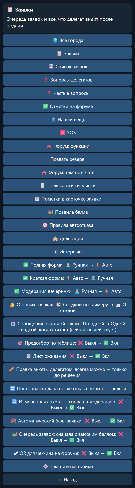

# Как включить автоотказ

## Что это

Бот может сам отклонять заявки по правилам. Пример: «младше 18 на дату форума», «курс из списка», «нет резюме». Делегат получает сообщение с причиной. Если он поправит анкету и условие больше не выполняется, заявка снова попадает в очередь на решение менеджера.

Правило можно не отклонять, а только пометить. Тогда заявка остаётся на модерации с пометкой имени правила, и автоодобрение её не забирает.

## Где находится

`/admin` → **📋 Заявки** → **🚫 Правила автоотказа**.

Кнопка стоит сразу под «🧮 Правила балла». Общий выключатель всех правил стоит на этом же экране.



*Цвет кнопок на снимке следует теме Telegram. Подписи и порядок такие, какие бот рисует сейчас. «🚫 Правила автоотказа» видны под «🧮 Правила балла».*

## Как включить

### 1. Открой список правил

`/admin` → **📋 Заявки** → **🚫 Правила автоотказа**.

Если правил ещё нет, бот пишет: заготовка «Младше 18 на дату форума» собирается в два тапа.

На этом экране:

- **➕ Новое правило**
- **✅ Включить все правила** или **🚫 Выключить все правила** (видят суперадмин и менеджер без привязки к городу; выключение спрашивает подтверждение)
- **🕘 Применить к уже поданным** (та же пара людей)
- **🤖 Автоотказы**
- **📊 Отчётность**

Пока общий выключатель выключен, вверху написано, что все правила выключены, а состояние каждого сохранено.

### 2. Создай правило

**➕ Новое правило**. На экране три заготовки и своё:

- **🧩 Младше 18 на дату форума**
- **🧩 Курс из списка** (берёт первые два курса из живого списка анкеты)
- **🧩 Нет резюме**
- **✏️ Своё правило**

Заготовка сразу открывает карточку. Правило создаётся выключенным: новые заявки оно не трогает, пока не нажмёшь **✅ Включить**.

Город правила: кнопка **🏙 Город** на карточке. Можно выбрать один город или «🌍 Все города».

### 3. Условия

В заготовке условия уже стоят. Их можно поправить.

В своём правиле:

- **➕ условие в группу 1**. Внутри группы должны выполниться все условия сразу.
- **➕ новая группа (ИЛИ)**. Достаточно условий любой одной группы.
- Бот сначала просит выбрать вопрос анкеты, потом условие, потом значение.

На карточке также чипы треков: **Полная**, **Краткая**, **Вечеринка**. Правило смотрит только отмеченные.

### 4. Напиши текст отказа

Кнопка **✏ Текст отказа**. Этот текст увидит делегат, когда правило отклоняет заявку. Напиши, почему отклонили и что можно исправить.

Имя для себя, делегат его не видит: **✏ Имя правила**. Пример: «Младше 18».

**Хороший пример текста:**

```
На дату форума тебе ещё не исполнится 18 лет. По правилам участия это обязательное условие.

Если дата рождения указана неверно, поправь анкету.
```

**Плохой пример:**

```
Отказ по правилу.
```

### 5. Посмотри, сколько заявок попадёт

На карточке **🔢 Сколько заявок попадёт**. Бот считает, сколько людей в городе и треках этого правила подошли бы под условия. Это просмотр, заявки при этом не меняются.

Если число сильно больше ожидаемого, проверь условия.

### 6. Включи правило

На карточке **✅ Включить**. Пока общий выключатель на списке тоже включён, правило работает для новых заявок.

Уже поданные заявки сами не пересматриваются. Чтобы пройти по ним, на списке правил нажми **🕘 Применить к уже поданным** (кнопка есть у суперадмина и у менеджера без привязки к городу). Повторный прогон никого не задвоит.

Действие на карточке: **↔ Действие**. «🚫 Отклонять» или «⚠️ Помечать для модератора».

## Действия правила

### «Отклонить»

Заявка уходит в отказ. Делегат получает текст отказа. Если после правки анкеты условие больше не выполняется, заявка снова попадает в очередь, и решение принимает менеджер.

### «Пометить»

Заявка остаётся на модерации с пометкой имени правила. Одобрять или отклонять её решаешь ты. Помеченная заявка не уходит в автоодобрение.

## Как посмотреть, кто попал под правила

- Очередь **📋 Заявки**: чип **«Только помеченные правилами»**. Чип виден, когда правила включены.
- **🤖 Автоотказы**: журнал попыток. У записи кнопка **«↩️ Вернуть: …»**, подтверждение «Вернуть заявку на модерацию?».
- **📊 Отчётность**: вкладка таблицы и размер пачки.

## Как выключить правило

Открой карточку → **🚫 Выключить**. Правило остаётся в списке, включить обратно можно той же кнопкой.

**🗑 Удалить** спрашивает подтверждение **«🗑 Да, удалить навсегда»**. Если правило включено, рядом есть **«🚫 Выключить вместо удаления»**.

Остановить все правила сразу: на списке **🚫 Выключить все правила** → **✅ Да, выключить**. Состояние каждого правила сохранится. Обратно включает **✅ Включить все правила**.

Выключенное правило перестаёт срабатывать сразу. Старые отказы в журнале остаются.

## Если что-то пошло не так

### Правило отклонило не тех

1. Открой **🤖 Автоотказы**.
2. **↩️ Вернуть: …** → подтверди возврат.
3. Заявка снова попадёт в очередь.

### Нужно временно остановить

**🚫 Выключить** на карточке останавливает одно правило. **🚫 Выключить все правила** останавливает все, не стирая их.

### Правило не срабатывает

Проверь:

- на списке написано «Сейчас правила работают», а не «все правила выключены»;
- на карточке стоит **✅ Включить** (кнопка при этом подписана **🚫 Выключить**);
- вопрос анкеты, на который опирается условие, включён. Если вопрос выключили или убрали вариант, в списке у правила значок ⚠️ и текст, на какой вопрос оно опиралось;
- **🔢 Сколько заявок попадёт** даёт ожидаемое число.

На карточке в этом случае бот может написать «⚠️ Правило пока не работает».
