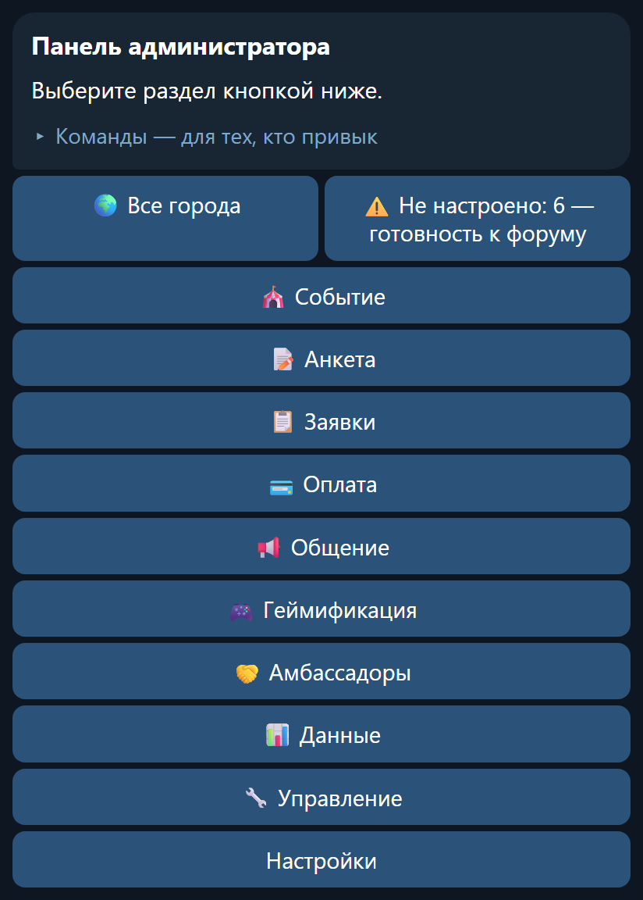
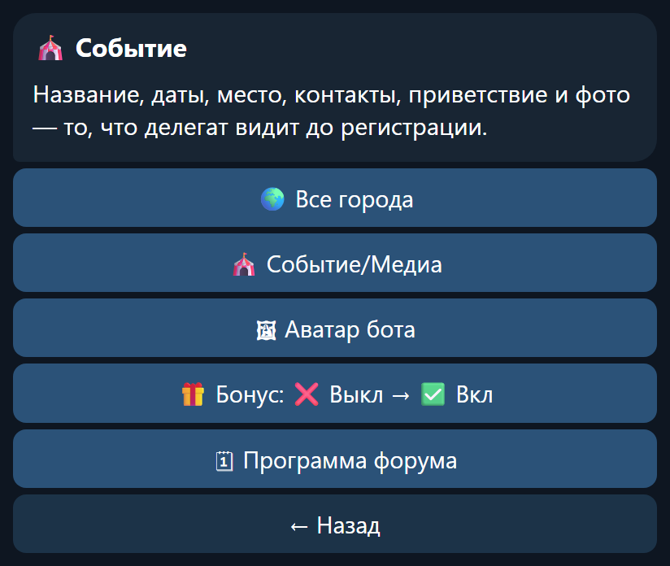
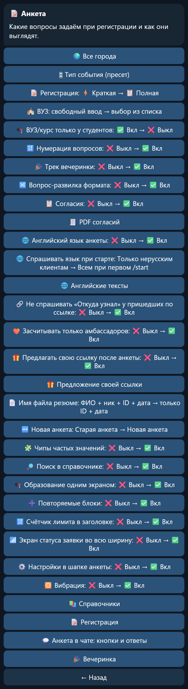
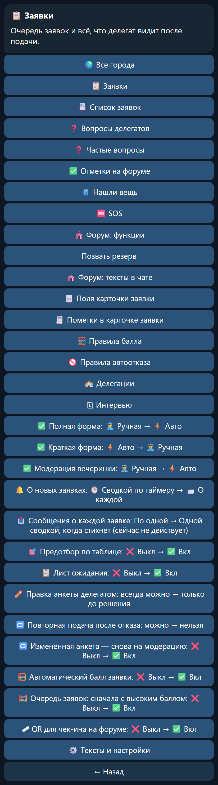
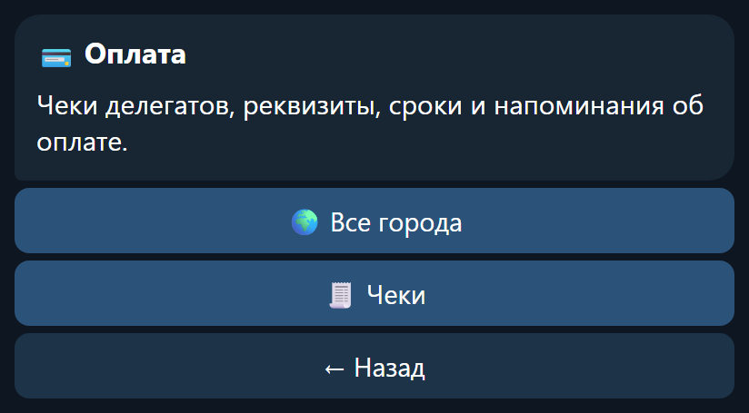
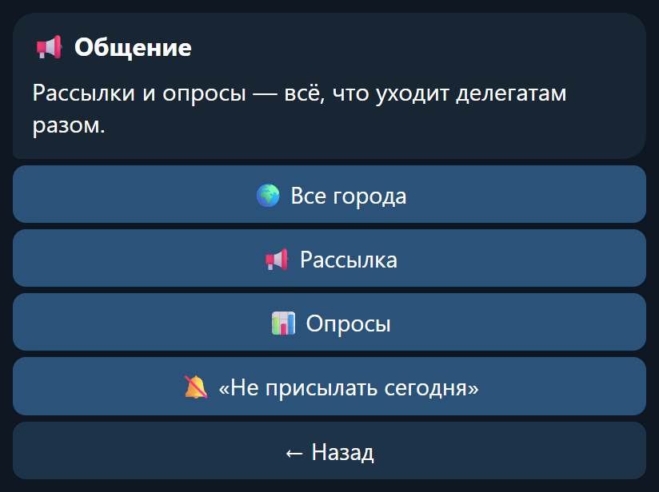
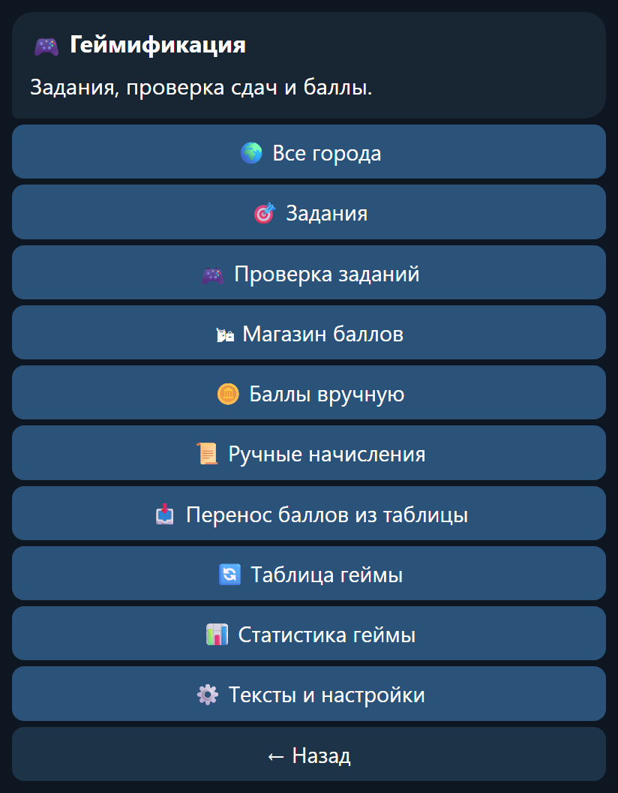
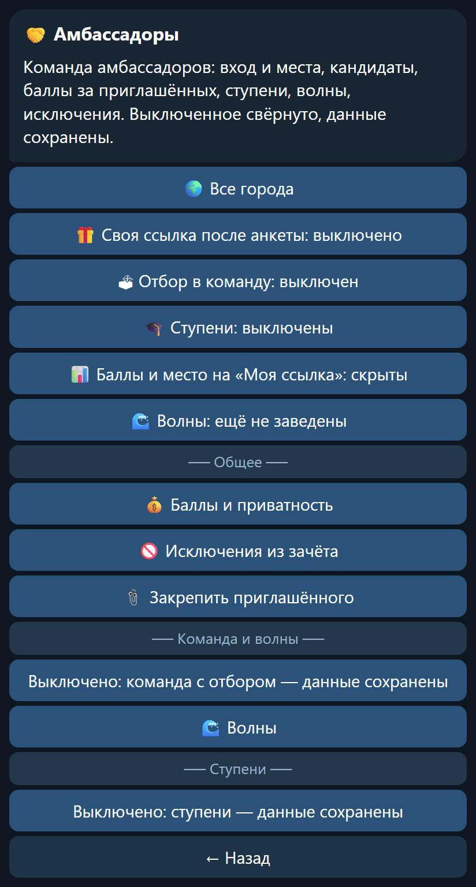
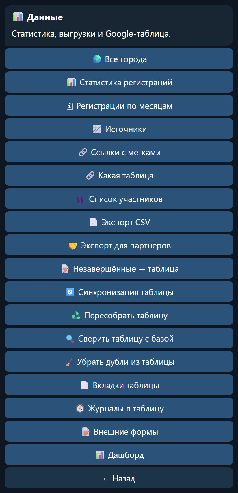
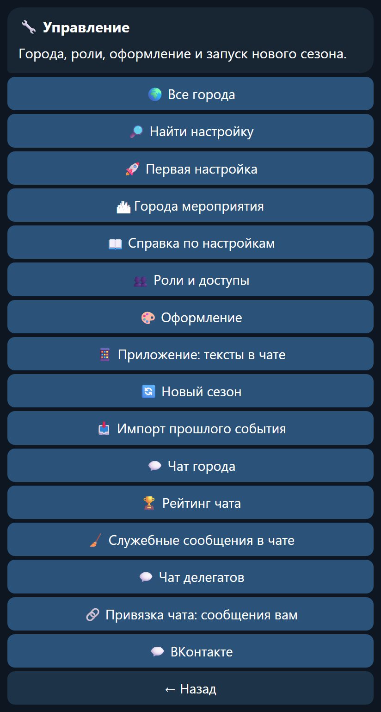

# Гайд менеджера на сезон

Панель открывается командой `/admin`. Заголовок: «👮‍♂️ Панель администратора». Если города включены, сверху кнопка «🌍 Все города» или «🏙 Город: …»: городские настройки ниже правятся для выбранного города. В режиме «🌍 Все города» дата закрытия регистрации закроет все города сразу.

Разделов девять. «🤝 Амбассадоры» видны и когда отбор в команду выключен: тогда «🚪 Вход и лимит» и «🙋 Кандидаты и команда» свёрнуты, а «🌊 Волны» остаются в этом разделе. Кнопка «Настройки» внизу корня открывает приложение. Она есть, когда у бота задан публичный адрес.

На новом событии строка готовности рядом с городом показывает, сколько пунктов первой настройки ещё не задано. Цвет кнопок на снимках следует теме Telegram. Подписи и порядок такие, какие бот рисует сейчас.

*Корень `/admin`. Сверху шапка города и готовность к форуму, дальше девять разделов. Команды спрятаны под строкой «Команды — для тех, кто привык».*

## Сезон по шагам

1. **Открыть регистрацию.** «📝 Анкета». Кнопка «📝 Регистрация: ⚡ Краткая → 📋 Полная» (или наоборот) переключает короткую и полную анкету. Вопросы и формулировки: приложение, режим «Настройки», строка «Вопросы анкеты». Закрытие по дате: группа «📝 Регистрация», пункт «🔒 Город: регистрация закрывается». Пустая дата значит, что город открыт. Дату ставят, выбрав город кнопкой сверху. «-» снова открывает город. Первые тексты и тип события можно пройти в «🔧 Управление» → «🚀 Первая настройка» (только суперадмин). Тип события: «🎛 Тип события (пресет)». Пункт «🎓 Форум СкиллАп» включает готовый набор, это не название мероприятия.

2. **Одобрить заявку.** «📋 Заявки» → «📋 Заявки». На карточке: «✅ Одобрить», «❌ Отклонить», при очереди «✅ Одобрить все (N)». Ручное или автоматическое одобрение: «✅ Полная форма: 👮 Ручная → ⚡ Авто» и «✅ Краткая форма: 👮 Ручная → ⚡ Авто».

3. **Оплата.** «💳 Оплата» → «🧾 Чеки». На карточке «✅ Подтвердить», «❌ Отклонить», «🧾 Чек». Включить оплату, тарифы, реквизиты, срок и тексты оплаты: приложение, режим «Настройки», строка «Оплата и согласия». Тумблер «⏰ Автонапоминания оплаты» лежит в строке «Запись и напоминания». Тексты напоминаний лежат рядом с тарифами.

4. **Рассылка.** «📢 Общение» → «📢 Рассылка». Бот спросит текст и аудиторию. Опросы: соседняя кнопка «📊 Опросы». Текст кнопки, которой делегат откладывает альбом на сегодня: группа «🔕 «Не присылать сегодня»».

5. **Чек-ин.** «📋 Заявки» → «✅ Отметки на форуме». Рядом, если нужны: «🧳 Нашли вещь», «🆘 SOS», «🎪 Форум: функции».

   Сертификаты живут в «🎪 Форум: функции». Новый вид заводится кнопками: кому он положен, какие поля печатать и есть ли версия на один день. Шрифт имени менеджер загружает своим файлом `.ttf` или `.otf`. Фразу на макете дизайнер пишет без рода: бот не выбирает «прошёл» или «прошла». Свой макет карточки QR менеджер загружает в «🔧 Управление» → «🎨 Оформление» → «🎟 Карточка QR», а код бот ставит сам.

6. **Баллы.** «🎮 Геймификация». «🎯 Задания» создают задание. «🎮 Проверка заданий» принимает или отклоняет сдачу. «🪙 Баллы вручную» начисляют без задания. Журнал: «📜 Ручные начисления». Магазин призов: «🛍 Магазин баллов».

7. **Новый сезон.** «🔧 Управление» → «🔄 Новый сезон». Только суперадмин. Бот попросит название сезона (пример на экране: «Форум'26») и подтверждение. Таблицу нового сезона при необходимости задают в «📊 Данные» → «🔗 Какая таблица».

## Девять разделов

Подробный разбор каждой кнопки: [ADMIN_GUIDE.md](ADMIN_GUIDE.md), раздел 3.

**🎪 Событие.** Дата, место, контакты, приветствие, фото: группа «🎪 Событие/Медиа». Рядом «🖼 Аватар бота», тумблер «🎁 Бонус» и «🗓 Программа форума». Кнопки меню делегата: приложение, строка «Кнопки меню делегата».

**📝 Анкета.** «🎛 Тип события (пресет)», переключатель краткой и полной регистрации, «🧾 PDF согласий», «🌐 Английские тексты», «📚 Справочники». Списки и даты: группа «📝 Регистрация». Вопросы: приложение, строка «Вопросы анкеты».

**📋 Заявки.** Очередь «📋 Заявки», «📇 Список заявок», «❓ Вопросы делегатов», «❓ Частые вопросы», отметки на форуме, «🚫 Правила автоотказа». Тексты после подачи: «⚙️ Тексты и настройки».

**💳 Оплата.** В боте одна кнопка: «🧾 Чеки». Тарифы, реквизиты и тумблер оплаты: приложение, строка «Оплата и согласия».

**📢 Общение.** «📢 Рассылка», «📊 Опросы» и группа «🔕 «Не присылать сегодня»».

**🎮 Геймификация.** «🎯 Задания», «🎮 Проверка заданий», «🛍 Магазин баллов», «🪙 Баллы вручную», «📜 Ручные начисления», «📥 Перенос баллов из таблицы», «🔄 Таблица геймы», «📊 Статистика геймы». Тексты баллов и заданий: «⚙️ Тексты и настройки». Волны и ступени живут в «🤝 Амбассадоры».

**🤝 Амбассадоры.** Сверху четыре строки: своя ссылка после анкеты, отбор в команду, ступени, баллы на «Моя ссылка». Дальше «🌊 Волны», «💰 Баллы и приватность», «🚫 Исключения из зачёта», «📎 Закрепить приглашённого». «🚪 Вход и лимит» и «🙋 Кандидаты и команда» раскрываются, когда включена строка «🗳 Отбор в команду». Тексты волн: приложение, строка «Амбассадоры».

**📊 Данные.** «📊 Статистика регистраций», «🗓 Регистрации по месяцам», «📈 Источники», «🔗 Ссылки с метками», «🔗 Какая таблица», «👥 Список участников», «📄 Экспорт CSV», «🤝 Экспорт для партнёров», «📝 Незавершённые → таблица», синхронизация, пересборка, сверка, дубли, «📄 Вкладки таблицы», «🕓 Журналы в таблицу», «📝 Внешние формы», «📊 Дашборд». «📄 Открыть таблицу» появляется, когда таблица подключена.

**🔧 Управление.** «🔎 Найти настройку», «🚀 Первая настройка», «🏙 Города мероприятия», «📖 Справка по настройкам», «👥 Роли и доступы», «🎨 Оформление», «📱 Приложение: тексты в чате», «🔄 Новый сезон», «📥 Импорт прошлого события», чат города, рейтинг чата, служебные сообщения, чат делегатов, привязка чата, «💬 ВКонтакте». «🔄 Сверить состав чата» появляется, когда чат уже привязан.

