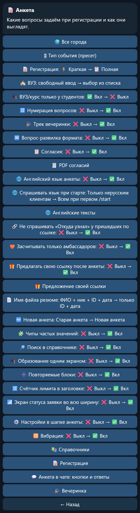

# 🎉 Party Flow — как работает и как настроить

Гайд для тестировщика/менеджера. В боте появился новый трек регистрации —
**«вечеринка» (party)**: отдельный поток для гостей, которые идут только на
вечеринку, а не на полное мероприятие.

## Суть

Один бот теперь обслуживает **три трека**:

- **Полный**: обычная регистрация делегата.
- **Вечеринка с ночёвкой**.
- **Вечеринка без ночёвки**.

У каждого трека — свой набор вопросов, своя модерация, свои тарифы и своя
вкладка в Google-таблице.

## Как гость попадает в party-трек

**Способ 1 — deep-link (основной).** Даёшь гостю ссылку:

- `t.me/<имя_бота>?start=party_over` — вечеринка **с ночёвкой**
- `t.me/<имя_бота>?start=party_noover` — вечеринка **без ночёвки**

Бот сразу ставит трек и ведёт по party-вопросам. Если гость в середине пришлёт
голый `/start` — трек сохраняется, не сбрасывается.

**Способ 2, развилка в боте.** Если включить «🔀 Вопрос-развилка формата» в «📝 Анкета», гость без ссылки увидит экран «Выбери формат участия» и сам выберет трек.

## Настройки (всё кнопками, файл окружения трогать не нужно)

Два тумблера трека стоят в `/admin` → **📝 Анкета**: «🎉 Трек вечеринки» и «🔀 Вопрос-развилка формата». Модерация: `/admin` → **📋 Заявки** → «✅ Модерация вечеринки».

*Цвет кнопок следует теме Telegram. «🎉 Трек вечеринки» и «🔀 Вопрос-развилка формата» на этом экране. Списки и текст «вечеринка закрыта» лежат в группе «🎉 Вечеринка» внизу.*

| Кнопка | Где | Что делает | По умолчанию |
|--------|-----|-----------|--------------|
| **🎉 Трек вечеринки** | 📝 Анкета | Пока выключен, вечериночные ссылки показывают «закрыто» | выкл |
| **✅ Модерация вечеринки** | 📋 Заявки | Вручную или автоматически | вручную |
| **🔀 Вопрос-развилка формата** | 📝 Анкета | Экран выбора трека без ссылки | выкл |
| **🎉 Текст «вечеринка закрыта»** | 📝 Анкета → группа «🎉 Вечеринка» | Что видит гость по ссылке, пока трек выключен | стандартный текст |
| **🎉 Вечеринка (Party)** | 📊 Данные → «📄 Вкладки таблицы» | Имя вкладки для заявок вечеринки | Party |

**Вопросы для вечеринки** открываются в приложении: режим «Настройки», строка **«Вопросы анкеты»**, колонка **«Вечеринка»**. Пока у вопроса нет своего значения, он берёт настройку полной анкеты и помечен «по умолчанию». Своё «задано» или «не задано» действует только на вечеринку.

Быстрый старт: «📝 Анкета» → **«🎛 Тип события (пресет)»** → **«🎉 Party»**. Пресет ставит типовой набор вечеринки (возраст, телефон, VK, город, аллергии, питание и вопросы про ночёвку). Полная анкета при этом остаётся как была.

**Тарифы для вечеринки** — приложение, режим «Настройки», строка «Оплата и согласия», пункт «💳 Варианты оплаты». Если тариф не для всех, третье поле пишет, кому он виден: «полная регистрация», «с ночёвкой», «без ночёвки». Пример строки только для вечеринки: `Вход на вечеринку|1000|с ночёвкой, без ночёвки`. Без третьего поля тариф виден всем.

## Что происходит при завершении

- Заявка уходит в очередь модерации; на карточке видно **🎉 Трек: вечеринка с
  ночёвкой / без**.
- После одобрения гость получает текст «🎉 После одобрения (Party)» из группы «🎉 Вечеринка» в «📝 Анкета», если он задан, и только тарифы вечеринки.
- Строка пишется **только во вкладку Party**, на главную вкладку НЕ попадает.
  Обычные регистрации — наоборот, только на главную.

## Важно про поведение

- Пока тумблер **«🎉 Трек вечеринки»** выключен, ссылка показывает текст «закрыто» и кнопку «Перейти к полной регистрации» (гость может уйти в обычный поток).
- Ночёвочные вопросы (проживание / кровать / сосед) задаются только треку
  **«с ночёвкой»**; «без ночёвки» их пропускает.
- Старые ссылки (`?start=12345` реферал, `?start=src_vk` источник) работают как
  раньше.

## Куда идут party-регистрации

Тот же Google-документ, те же доступы. Заявки вечеринки пишутся на **отдельную вкладку** той же таблицы. Имя вкладки: «📊 Данные» → «📄 Вкладки таблицы» → «🎉 Вечеринка (Party)». Пустое имя даёт вкладку Party.
Вкладка создаётся автоматически, если её нет. **Ничего в .env добавлять не
нужно.**

## Чтобы проверить

Подробный чеклист из 10 шагов — в
`.planning/phases/05-participant-tracks-party-delegates/05-HUMAN-UAT.md`.
Начни с: включи «Трек вечеринки», применить пресет 🎉 Party, поставь ручную
модерацию — и пройди по ссылке `?start=party_over`.
